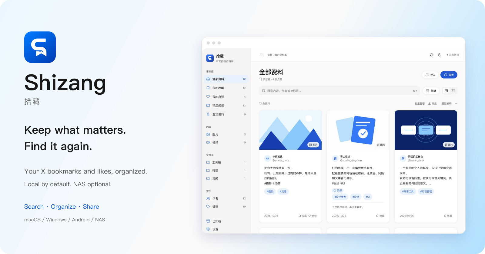

[简体中文](README.md) | **English**

<div align="center">
  
  <h1>Shizang · 拾藏</h1>
  <p><strong>Keep what matters. Find it again.</strong></p>
  <p>A personal library for your X / Twitter bookmarks and likes.<br />Use it on your computer without a NAS. Add a shared library when you need one.</p>
  <p><a href="#features">Features</a> · <a href="#quick-start">Quick start</a> · <a href="docs/shared-library.en.md">Shared library</a> · <a href="#building">Building</a></p>
  <p><code>macOS</code> <code>Windows</code> <code>Optional shared library</code></p>
</div>

<p align="center"></p>

## Why Shizang

A saved post is only useful if you can find it later. Shizang turns your bookmarks and likes into a library you can search, filter and organize.

**The desktop app works on its own.** Bookmarks, likes, tags, notes, indexes and videos you explicitly save are managed in the local library by default. No NAS, Docker or separate server is required.

Remote storage is optional. If you configure it, you can use a library hosted on a cloud server, an ordinary computer, a home server or your own NAS. Connect your devices to the same library when you want to share it.

The current development and release scope is Mac and Windows. Android and iOS source projects are retained; mobile development and releases are deferred.

## Features

| Find | Organize | Use on your devices |
|---|---|---|
| Search text, authors, tags, notes and quoted posts | Add tags, folders and notes | Sync from macOS or Windows |
| Combine keywords, source, media and date filters | Mark as read, pin, archive and restore | Use a local desktop library |
| Automatically index post hashtags | Merge duplicate posts while preserving both sources | Host a shared library on a computer, server or NAS |
| Author and tag suggestions and directories | Export JSON backups and CSV | Switch between local and remote libraries |

- **Incremental sync.** Sync new bookmarks, likes or both. Reading stops when a full page is already in the library.
- **Find videos by author.** Author cards show post and video counts. Author and tag directories use a responsive grid with continuous browsing and full-directory search.
- **Rediscover saved posts.** Choose random order from the sort menu, with search and filters still applied. The order stays consistent across pages; use reshuffle to start a new round.
- **Save videos when you choose.** Images and unsaved videos load directly from X on the viewing device. The desktop app can explicitly save selected videos to the current library.
- **Bring existing data.** Import Shizang JSON backups, X `like.js` files, tweet JSON and CSV files containing post IDs or original links.

## Screenshots

### Browse and search


<details>
<summary>Author directory, tag directory and dark mode</summary>


</details>

Screenshots use a separate demonstration library. The application interface is currently in Simplified Chinese.

## Quick start

### Desktop, without a NAS

Running from source requires **Node.js 24.22.0 or newer 24.x** and Git. Desktop installers include their runtime.

The first desktop launch or package build from source downloads the Electron runtime.

```sh
git clone https://github.com/1606835963aa/X-like.git
cd X-like
npm ci --cache ./tmp/npm-cache
npm run build
npm start
```

1. Open Shizang. It uses a local library on this computer by default.
2. Connect your X account through the official X page opened by the desktop app.
3. Start a sync for new bookmarks, likes or both.
4. Search your library and organize posts with tags, folders and notes.

Sync on startup is off by default and can be enabled in Settings. Rate limits, expired sessions and account verification stop the sync. Rate-limit waiting periods survive a restart; you can sync manually once the wait ends.

In Settings, switch between the local library and your saved remote library with one click. The remote address and credentials remain encrypted on this computer, and the app remembers your selected library after a restart.

### Share between computers

Start the library service from the project directory:

```sh
npm run server
```

The service prints a pairing code and stores data in the project's `data/` directory.

1. Connect the desktop app to `http://127.0.0.1:5368` and enter the pairing code.
2. Connect another desktop to `http://<computer-LAN-address>:5368` with the same code.
3. Browse and organize the same library on both computers; sync new posts from the computer signed in to X.

Keep the service computer running and make sure the devices can reach it. See the [shared-library guide](docs/shared-library.en.md) for configuration, migration and backups.

### NAS or home server

The same service can run continuously on a NAS or another server. Docker and ARM64 offline deployment are covered in the [shared-library guide](docs/shared-library.en.md#docker-and-nas).

To move existing local data, export a JSON backup, switch to the shared library and import the backup. Switching libraries does not move data automatically.

## Local by default, remote storage optional

| Content | Location |
|---|---|
| X login session | The computer where you sign in |
| Text, authors, sources, tags and organization | The selected local or shared library |
| Images and unsaved videos | Loaded directly from X by the viewing device |
| Videos explicitly saved from the desktop app | The selected library |
| Shared-library connection | Each computer's device access credential |

The shared service receives no X login cookies and does not download media from X. Devices access it using its address and a device credential.

JSON backups preserve content, sources, tags, notes and organization. Back up the full service data directory to preserve saved media and device connections as well.

Local desktop data lives in the `library` folder inside the system’s Shizang application-data directory. Quit the app before copying that folder for a full local backup. Use JSON export and import to move records between libraries.

## Platform status

| Platform | Status |
|---|---|
| macOS 13+ · Apple Silicon | Built and runtime-verified, including login, sync and optional shared-library access |
| Windows 10 / 11 · x64 | Compatibility is handled on a Windows computer; see the [Windows acceptance checklist, Chinese](docs/Windows验收.md) |
| NAS · Linux ARM64 | Docker offline deployment and shared-library access verified |
| Android / iOS | Outside the current development and release scope |

## Building

Desktop installers are written to `release/`:

```sh
npm run package:mac
npm run package:win
```

Formal signing and notarization are deferred. Mac builds use an ad-hoc signature; Windows builds have no publisher signature. Distributions include AGPLv3 and third-party notices.

Checks and icon generation:

```sh
npm test
npm run test:collector
node scripts/icons.mjs
```

The frontend uses React, desktop uses Electron and the service uses Node.js built-in SQLite. Devices communicate with the library over HTTP.

Startup failures offer logs, retry and database recovery. Schema upgrades create a validated backup before making changes and roll back on failure. Restore preserves the previous database and leaves saved media in place. See the [development and recovery guide, Chinese](docs/开发.md).

- [Shared-library deployment](docs/shared-library.en.md)
- [Development guide, Chinese](docs/开发.md)
- [Design guidelines, Chinese](design/DESIGN.md)
- [Brand assets, Chinese](design/品牌.md)
- [Report an issue](https://github.com/1606835963aa/X-like/issues)

The organization of the self-hosted library was informed by [Karakeep](https://github.com/karakeep-app/karakeep).

## License

Licensed under the [GNU Affero General Public License v3.0](LICENSE) (`AGPL-3.0-only`).
