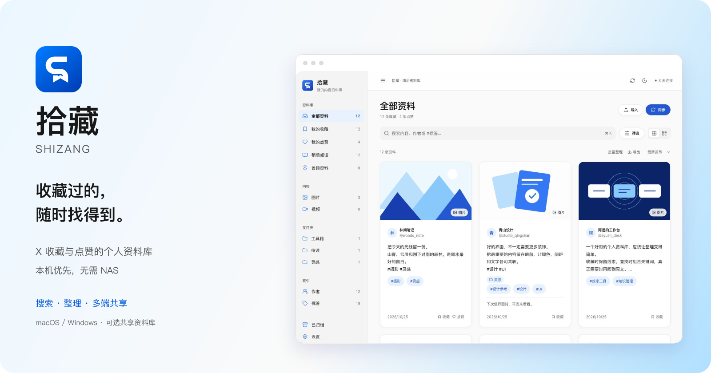
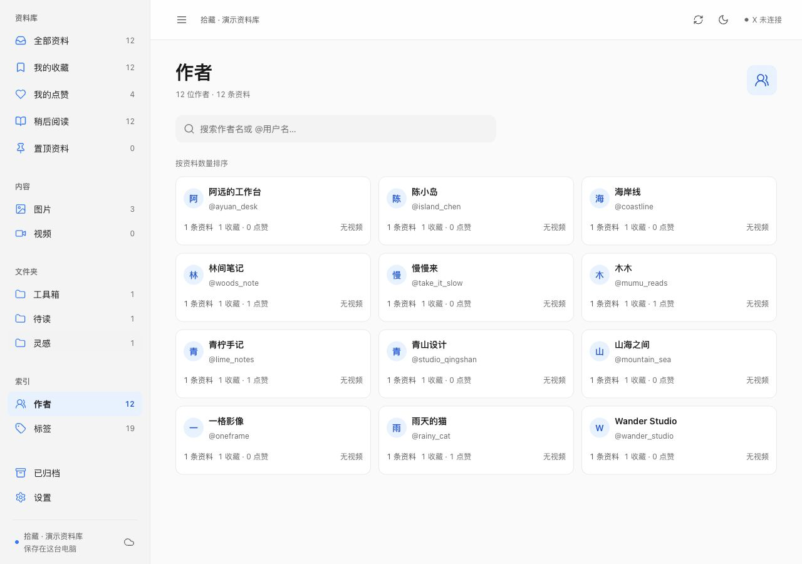
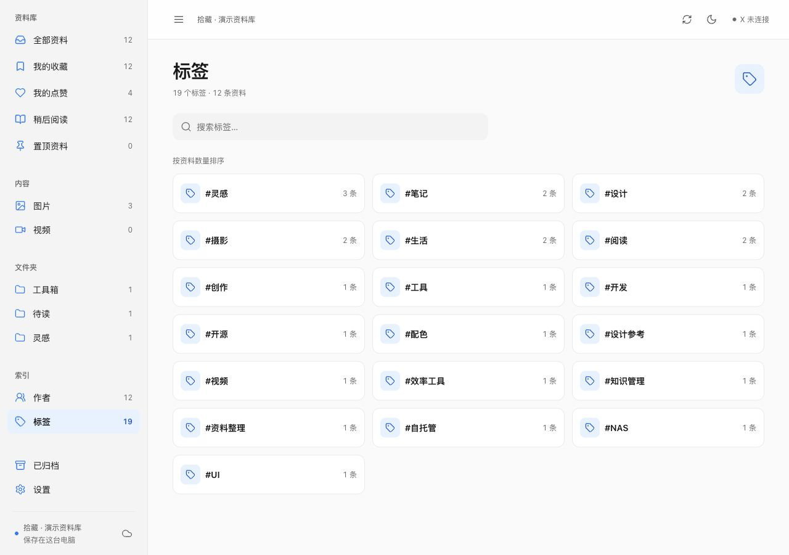
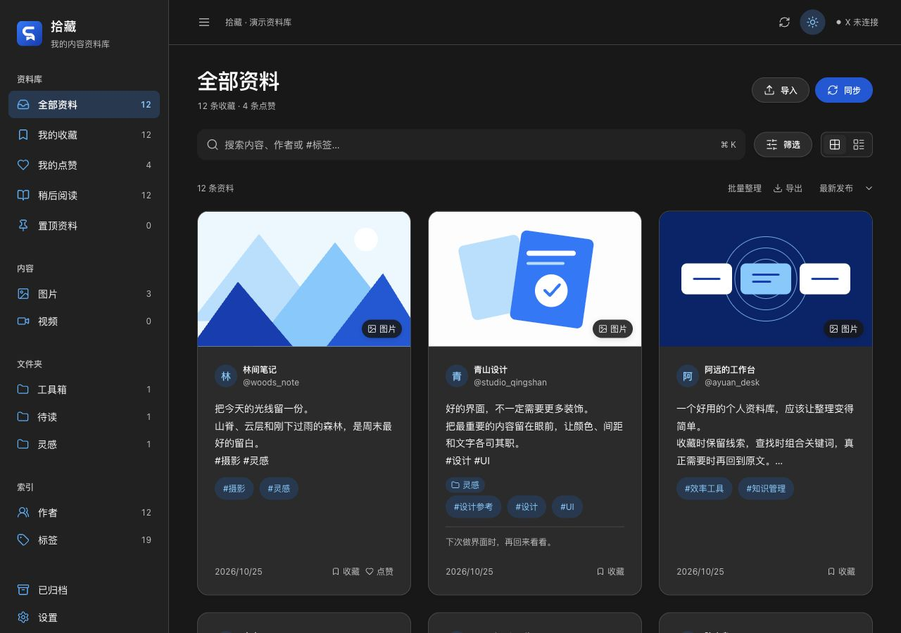

**简体中文** | [English](README.en.md)

<div align="center">
  
  <h1>拾藏 · Shizang</h1>
  <p><strong>收藏过的，随时找得到。</strong></p>
  <p>管理 X / Twitter 收藏与点赞的个人资料库。<br />电脑版默认保存到本机，无需 NAS。需要时，再连接共享资料库。</p>
  <p><a href="#下载">下载安装</a> · <a href="#功能一览">功能一览</a> · <a href="#快速开始">快速开始</a> · <a href="docs/共享资料库.md">可选共享</a> · <a href="docs/开发.md">开发与构建</a></p>
  <p><code>macOS</code> <code>Windows</code> <code>可选共享资料库</code></p>
</div>

<p align="center"></p>

## 为什么做拾藏

收藏越来越多，想找回某条帖子时，却只记得一个关键词、一个作者，或者一个话题。拾藏把这些内容组织成可搜索、可筛选、可整理的资料库。

**电脑版默认保存在本机。** 收藏、点赞、标签、备注、索引和手动保存的视频，都可以在本机资料库中管理，不需要 NAS、Docker 或额外服务器。

**远程存储是可选项。** 用户主动配置后，可以将资料保存到云服务器、普通电脑、家庭服务器或自己的 NAS 上。多台电脑连接同一份资料库即可共享。

当前开发和发行范围是 Mac 与 Windows。安卓和 iOS 工程保留，手机端暂不开发和发布。

## 功能一览

| 找到资料 | 整理资料 | 在自己的设备上使用 |
|---|---|---|
| 正文、作者、标签、备注与引用内容搜索 | 自定义标签、文件夹与备注 | Mac / Windows 登录与同步 |
| 多关键词、来源、媒体和日期组合筛选 | 已读、置顶、归档与恢复 | 本机资料库独立使用 |
| 帖子 `#话题标签` 自动建立索引 | 收藏与点赞去重，保留两个来源 | 电脑 / 服务器 / NAS 自托管共享 |
| 作者、标签联想与完整目录 | JSON 备份与 CSV 导出 | 本机与远程资料库一键切换 |

- **从新增内容开始。** 手动同步收藏、点赞或两者，遇到整页已收录内容就停止读取。
- **按作者找视频。** 作者目录统计资料与视频数量，点击视频入口即可筛选；作者和标签目录支持三列卡片、连续滚动与全目录搜索。
- **随机发现旧收藏。** 在排序菜单选择“随机排序”，可与搜索、作者和标签筛选组合使用。翻页时顺序保持一致，点击“重新打乱”换一轮顺序。
- **按需保留视频。** 图片和未保存的视频由当前设备直接读取 X。电脑端可以手动将选定视频保存到资料库，供其他设备查看。
- **带着资料继续使用。** 支持拾藏 JSON 备份、X 的 `like.js`、推文 JSON，以及包含推文编号或原文链接的 CSV 导入。

## 界面预览

### 浏览与查找


<details>
<summary>查看作者目录、标签目录与深色主题</summary>







</details>

截图使用独立演示资料。

## 下载

当前版本：[**拾藏 0.1.1**](https://github.com/1606835963aa/X-like/releases/tag/v0.1.1)。

| 系统 | 下载 | 安装方式 |
|---|---|---|
| macOS 13+ · Apple Silicon（M 系列芯片） | [Mac 安装包 · ZIP](https://github.com/1606835963aa/X-like/releases/download/v0.1.1/Shizang-0.1.1-macOS-arm64.zip) | 解压后将「拾藏.app」拖入「应用程序」 |
| Windows · x64（64 位） | [Windows 安装包 · EXE](https://github.com/1606835963aa/X-like/releases/download/v0.1.1/Shizang-0.1.1-Windows-x64.exe) | 运行安装包，按向导完成安装 |

安装包内置运行环境，无需安装 Node.js、Docker 或配置 NAS。发布页提供两个安装包的 [SHA-256 校验值](https://github.com/1606835963aa/X-like/releases/download/v0.1.1/SHA256SUMS-0.1.1.txt)。

## 快速开始

### 在电脑上使用

1. 打开拾藏，默认使用这台电脑的本机资料库。
2. 点击“连接我的 X 账号”，在软件打开的 X 官方页面登录。
3. 点击“同步”，选择新增收藏、点赞或两者。
4. 使用搜索、作者目录和标签目录查找资料，再按需要补充备注、标签与文件夹。

打开软件时自动同步默认关闭，可以在设置中主动开启。遇到限流、登录失效或账号验证时，同步会停止；限流等待时间会保留到重启后，到期后可手动同步。

在“设置 → 资料库”中可一键切换本机和已连接的远程资料库。远程地址与连接凭证加密保留，切回本机后不用重新输入，重启会恢复上次的选择。

### 从源码运行

需要 **Node.js 24.22.0 或更新的 24.x** 和 Git。首次启动或打包时会下载 Electron 运行时。

```sh
git clone https://github.com/1606835963aa/X-like.git
cd X-like
npm ci --cache ./tmp/npm-cache
npm run build
npm start
```

自行构建安装包时，输出位于 `release/`，见 [开发与构建](docs/开发.md)。

### 多台电脑共用资料

在一台普通电脑上启动资料库服务：

```sh
npm run server
```

服务启动后会显示连接码，资料保存在项目的 `data/` 目录。

1. 这台电脑上的拾藏连接 `http://127.0.0.1:5368`，填写服务显示的连接码。
2. 另一台电脑连接 `http://<服务电脑的局域网地址>:5368`，填写同一个连接码。
3. 两台电脑查询和整理同一份资料，由登录 X 的电脑同步新增内容。

运行服务的电脑需要保持开机，设备之间网络互通。服务的使用和备份方法见 [共享资料库](docs/共享资料库.md)。

### 已有 NAS 或家庭服务器

也可以将资料库服务部署到 NAS 或服务器，让它持续运行。Docker 与 ARM64 离线部署见 [NAS 部署](docs/NAS部署.md)。

本机资料与远程资料相互独立，切换不会删除或自动搬移已有资料。需要迁移时，可以先导出 JSON，再切换到共享资料库导入。

## 默认本机保存，远程存储可选

| 内容 | 保存位置 |
|---|---|
| X 登录状态 | 登录的那台电脑 |
| 正文、作者、来源、标签与整理信息 | 当前选择的本机或共享资料库 |
| 图片与未保存的视频 | 由当前设备直接读取 X，不自动写入资料库 |
| 手动保存的视频 | 当前选择的资料库 |
| 共享资料库连接 | 各电脑的设备连接凭证 |

共享资料库不接收 X 登录 Cookie，也不主动向 X 下载媒体。电脑通过服务地址和设备凭证访问资料库。

JSON 备份包含正文、来源、两类标签、备注与整理状态。完整备份媒体与设备连接信息时，需要同时备份服务的 `data` 目录，见 [备份和恢复](docs/NAS部署.md#备份和恢复)。

本机资料保存在系统“拾藏”应用数据目录中的 `library` 文件夹。备份本机资料时，退出拾藏后复制该文件夹；跨资料库迁移可使用 JSON 导出和导入。

## 平台状态

| 平台 | 当前状态 |
|---|---|
| macOS 13+ · Apple Silicon | 已构建并完成运行验证，包括登录、同步与可选共享资料库 |
| Windows 10 / 11 · x64 | Windows 11 本机核心流程已实机通过；Windows 10 与真实账号流程待验，见 [Windows 验收](docs/Windows验收.md) |
| NAS · Linux ARM64 | Docker 离线部署与资料共享已验证 |
| Android / iOS | 不在当前开发和发行范围 |

## 开发与参与

前端使用 React，桌面使用 Electron，资料库服务使用 Node.js 内置 SQLite。设备通过 HTTP 接口访问资料库。

Mac 正式签名与 Windows 发布者签名暂缓，当前发行包包含项目协议与第三方许可。启动失败时可查看日志或从升级前备份恢复，使用方法见 [开发与构建](docs/开发.md#启动与恢复)。

- [开发、测试与打包](docs/开发.md)
- [普通电脑上的共享资料库](docs/共享资料库.md)
- [NAS 部署](docs/NAS部署.md)
- [界面规范](design/DESIGN.md)
- [Logo 与图标](design/品牌.md)
- [问题反馈](https://github.com/1606835963aa/X-like/issues)

资料库的组织方式参考了 [Karakeep](https://github.com/karakeep-app/karakeep)。

## 许可

本项目采用 [GNU Affero General Public License v3.0](LICENSE)（`AGPL-3.0-only`）。
